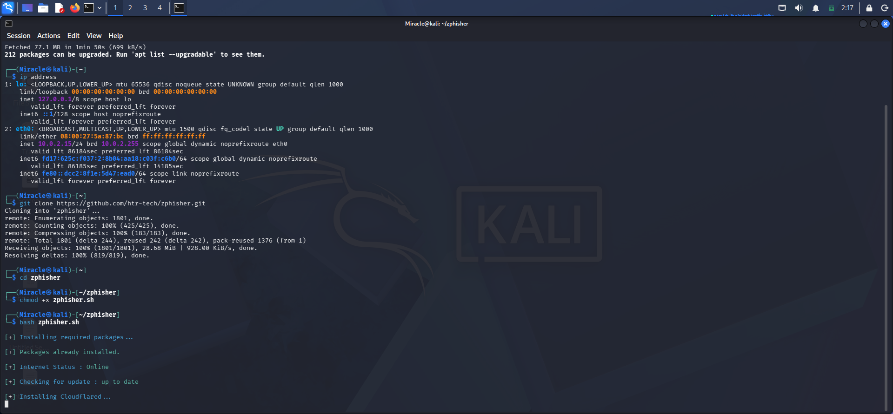
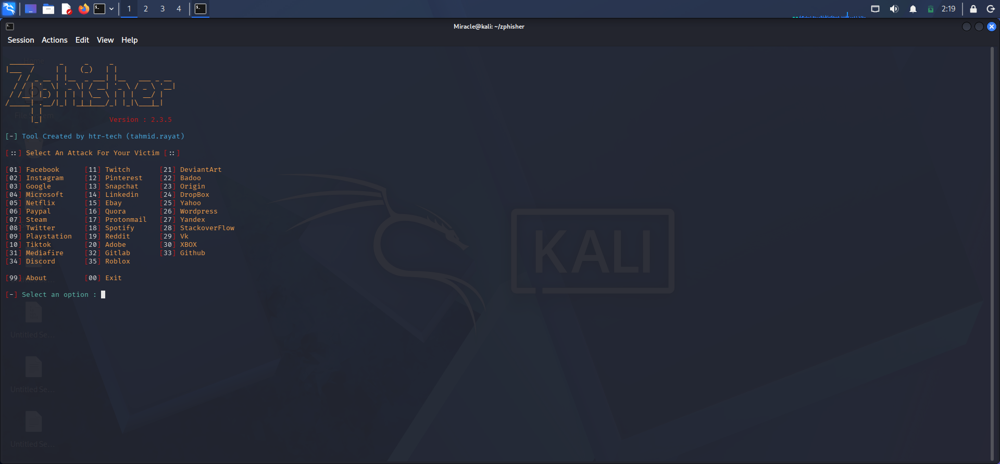
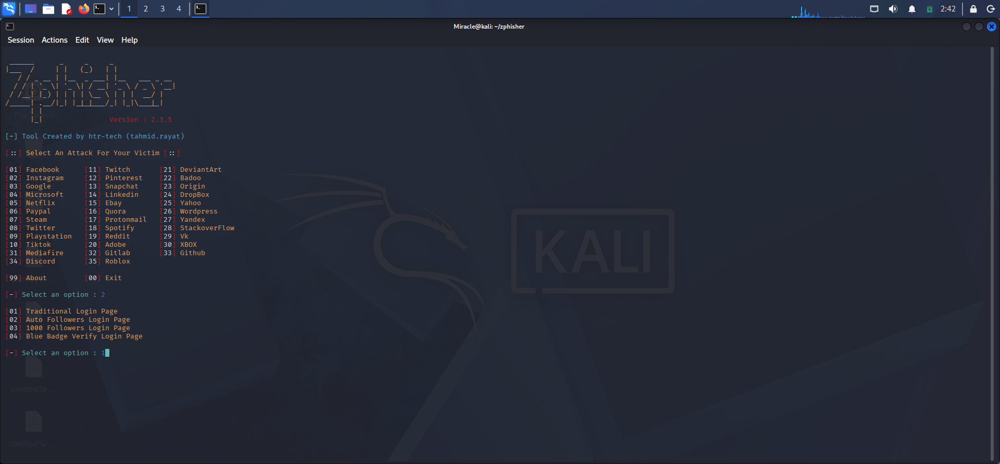
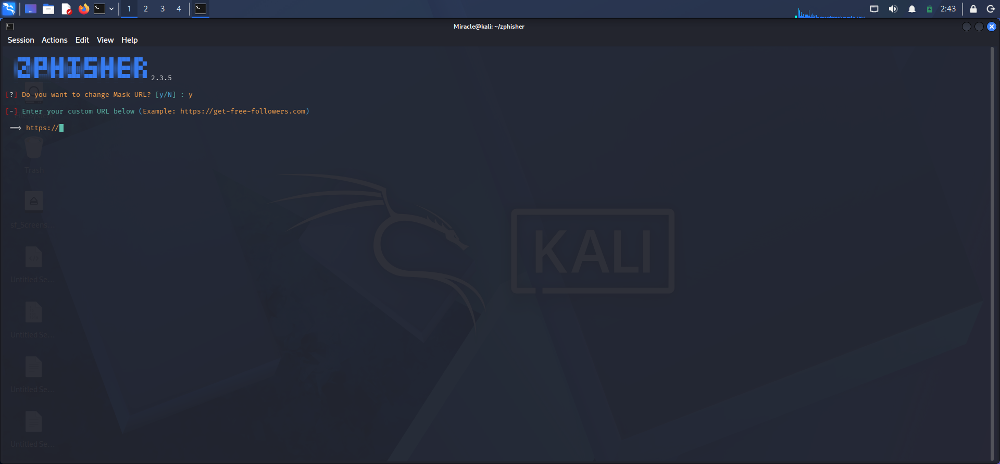
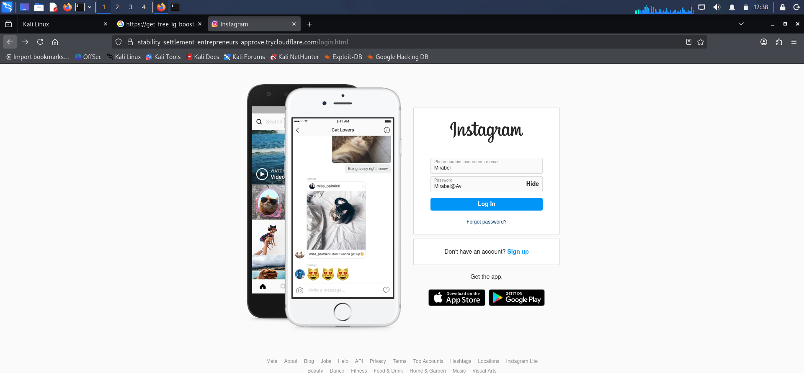
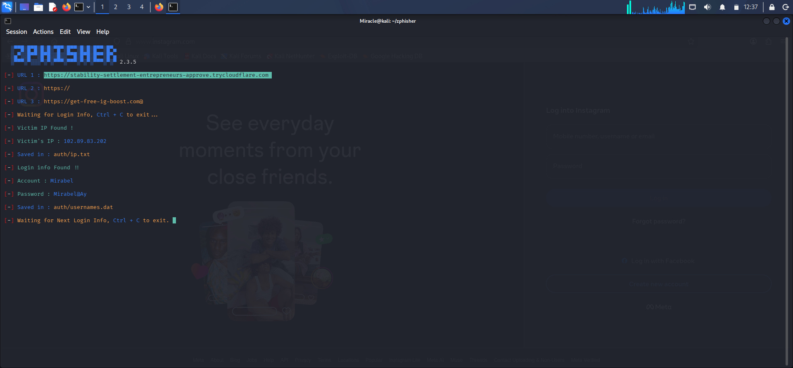

# **Phishing Awareness Simulation**

## Project Overview

This project demonstrates a controlled phishing awareness simulation conducted in a cybersecurity laboratory for the Nexus Bank security assessment exercise. Using Kali Linux and Zphisher, the project examines how deceptive login pages can imitate legitimate services and explores practical measures for reducing phishing-related risks. The project includes testing evidence, documented findings, and defensive recommendations.

## The Problem

Nexus Bank faces the risk of phishing attacks targeting employees through deceptive links and fraudulent login pages. An employee who mistakes a malicious page for a legitimate service could expose sensitive credentials, potentially leading to account compromise, unauthorised access, or data breaches.

The organisation needs to understand how these deceptive pages operate and how security awareness and technical controls can reduce the likelihood of employees falling victim to phishing attacks.

## The Solution

A controlled phishing awareness simulation was conducted using Kali Linux and Zphisher to demonstrate the behaviour of a phishing-style page in a laboratory environment.

The exercise produced screenshots documenting the laboratory setup, tool configuration, template selection, demonstration URL, browser activity, and terminal test results. These materials support the accompanying report, which documents the observations, findings, limitations, and defensive recommendations.

Recommended defences include employee awareness training, phishing-resistant multifactor authentication, email filtering, suspicious-link reporting, and regular security assessments.

## How It Works

Zphisher is configured in Kali Linux to run a phishing-style demonstration within a controlled laboratory. Screenshots and terminal observations document the process, while the findings are compiled into a report to support security awareness and recommend appropriate defensive measures.

## Screenshots and Evidence

The following evidence shows the stages of the laboratory exercise.

### Laboratory Environment

*The laboratory environment prepared for the simulation.*

### Zphisher Setup

*The Zphisher setup in the Kali Linux environment.*

### Template Selection

*The template selection stage of the demonstration.*

### Demonstration URL Configuration

*The URL configuration used for the laboratory exercise.*

### Browser Demonstration

*The phishing-style demonstration page viewed in a browser.*

### Terminal Test Result

*Terminal output captured during the simulation. Interpret the result according to the actual evidence.*

## Project Report

The complete report contains the testing methodology, findings, screenshot captions, evidence guide, limitations, and defensive recommendations.

**[Read the Phishing Simulation Report (PDF)](docs/phishing-simulation-report.pdf)**

## Tech Stack

- **Kali Linux** — Cybersecurity laboratory environment.
- **Zphisher** — Phishing simulation tool.
- **Web Browser** — Demonstration page inspection.
- **Linux Terminal** — Tool configuration and test observation.

## Privacy and Data Handling

- **Controlled environment:** Testing was intended for an authorised laboratory setting.
- **Data protection:** Published evidence must not expose real credentials, session cookies, access tokens, or confidential information.
- **Responsible testing:** The simulation is intended for authorised laboratory use, not for targeting real users or production systems.
- **Public documentation:** Screenshots and reports should be checked for sensitive information before publication.
- **Evidence integrity:** Findings must accurately reflect the observations recorded during testing.

## Executed By

**Miracle Balogun Abiodun**

Cybersecurity Expert | Network Security | Vulnerability Assessment | Ethical Hacking

### Contact

- **Email:** [balogunmiracleabbey04@gmail.com](mailto:balogunmiracleabbey04@gmail.com)
- **X:** [@miraclemimix](https://x.com/miraclemimix?s=11)
- **WhatsApp:** [07051160995](https://wa.me/2347051160995)

---

*Cybersecurity | Phishing Awareness | Security Assessment*

*Disclaimer: This project is intended for educational purposes and authorised security testing only.*
